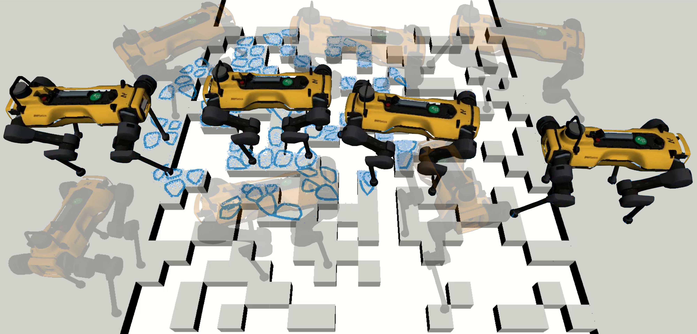

# QuadPiPS: A Perception-informed Footstep Planner for Quadrupeds With Semantic Affordance Prediction


<p align="center">
    <a href="https://arxiv.org/abs/2501.00112">arXiv</a> •
    <a href="#Citation">Citation</a>

</p>

<p>
     
</p>

## <a name="Citation"></a>Citation
If would like to cite this work, please use the following format:
```
@misc{asselmeier2026quadpipsperceptioninformedfootstepplanner,
      title={QuadPiPS: A Perception-informed Footstep Planner for Quadrupeds With Semantic Affordance Prediction}, 
      author={Max Asselmeier and Ye Zhao and Patricio A. Vela},
      year={2026},
      eprint={2501.00112},
      archivePrefix={arXiv},
      primaryClass={cs.RO},
      url={https://arxiv.org/abs/2501.00112}, 
}
```
